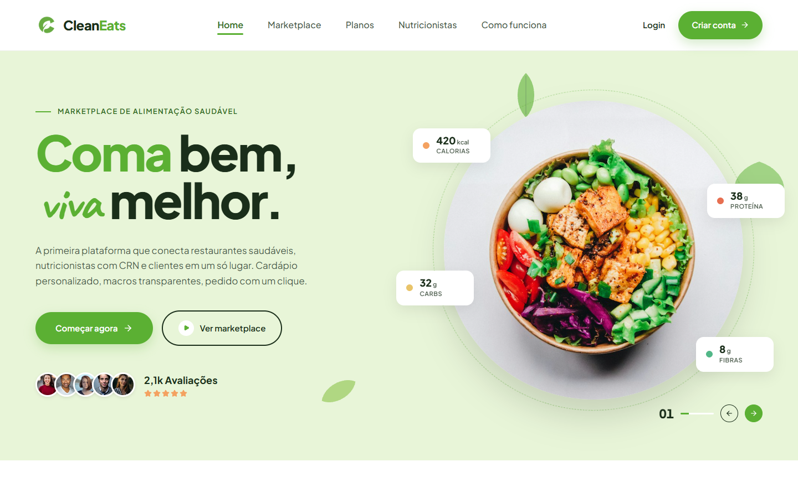
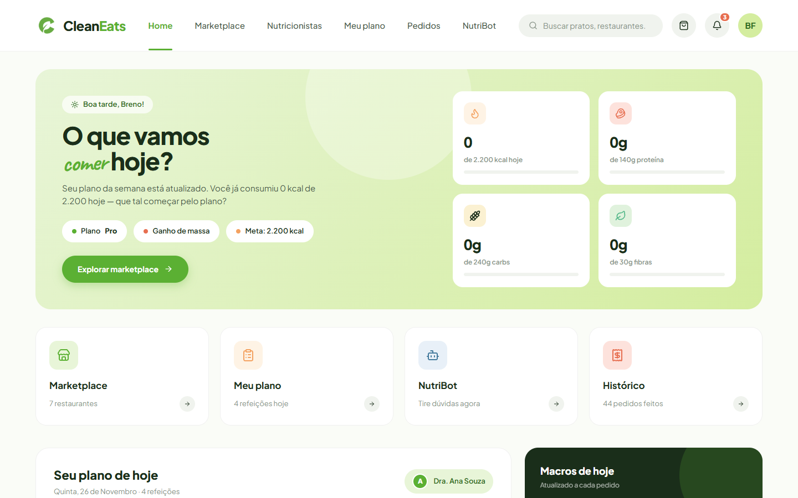
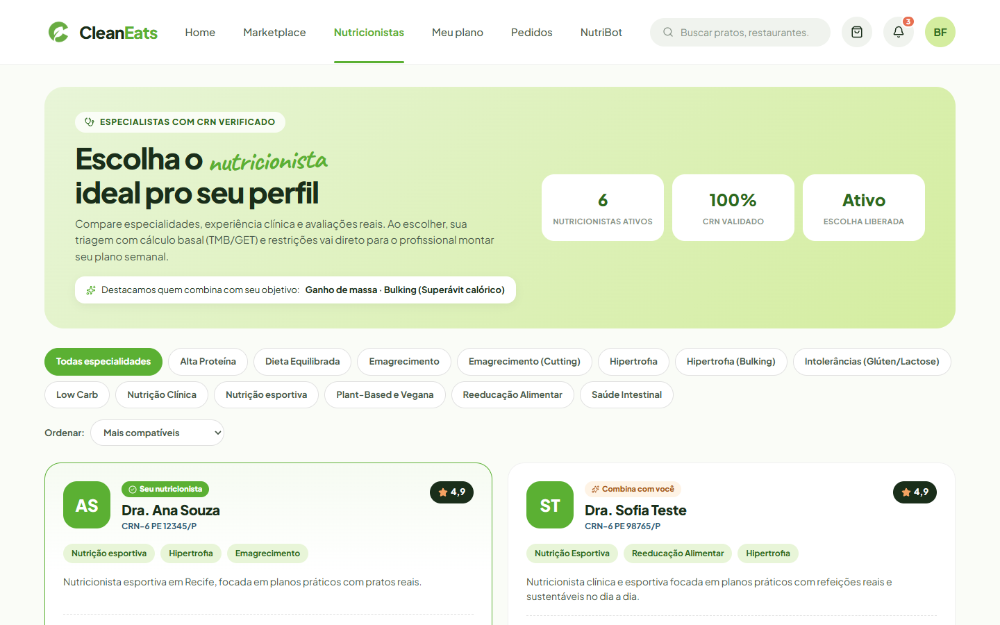
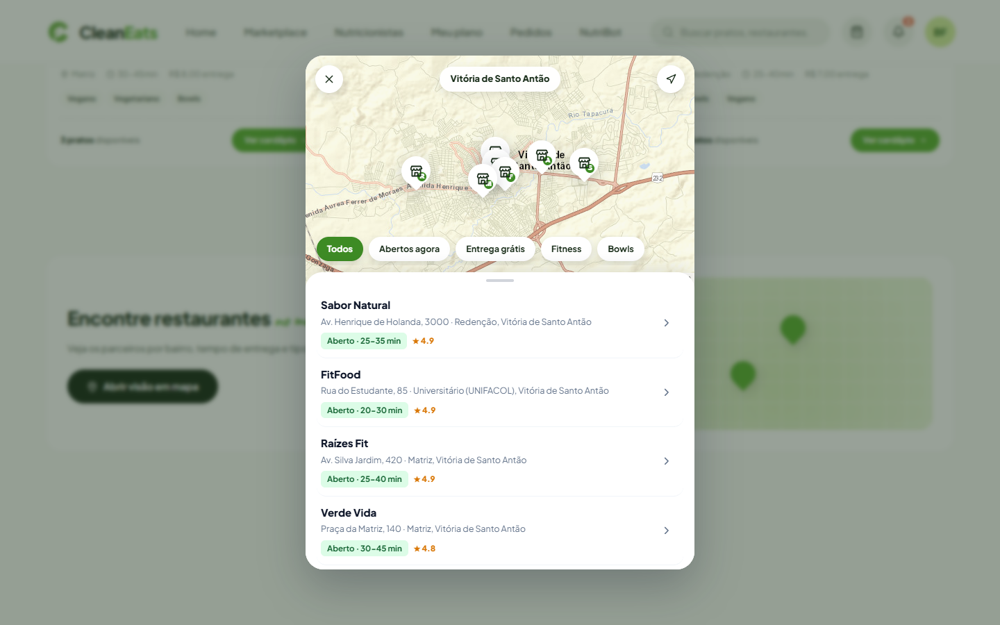
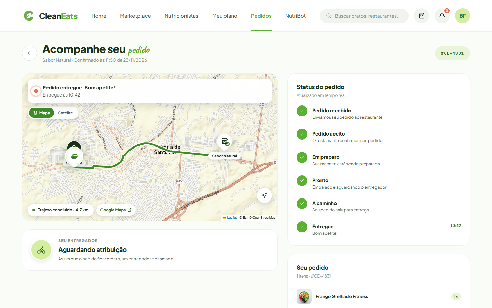
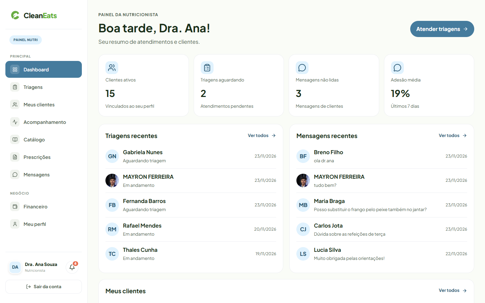
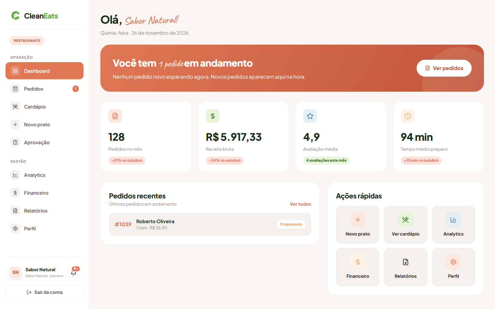

<div align="center">
  

  <h3>Coma bem, viva melhor.</h3>

  <p>
    Ecossistema completo de alimentação saudável e acompanhamento nutricional que conecta
    <strong>clientes</strong>, <strong>nutricionistas com CRN</strong> e <strong>restaurantes parceiros</strong>
    em <strong>Vitória de Santo Antão - PE</strong>.
  </p>

  <p>
    <a href="https://cleaneats-red.vercel.app">
      
    </a>
  </p>

  <p>
    
    
    
    
    
    
    
    
  </p>
</div>

---

## Sobre o projeto

O **CleanEats** foi desenvolvido pela **TRICODE Solutions** na disciplina de **Fábrica de Software** do curso de **Sistemas de Informação — UNIFACOL**.

Diferente de um app comum de delivery, a plataforma integra **nutrição clínica real** ao pedido do dia a dia: o cliente descobre suas metas basais, escolhe um nutricionista compatível com seu objetivo, recebe um plano semanal composto por **pratos reais do marketplace** (com ficha técnica nutricional e QR Code) e acompanha cada entrega em tempo real no mapa.

---

## Telas do sistema

### Página inicial (Landing Page)
<p align="center">
  
</p>

### Experiência do Cliente
<table>
  <tr>
    <td width="50%" valign="top">
      <strong>Home do Cliente & Metas Diárias</strong><br />
      Resumo de calorias e macros (TMB Mifflin-St Jeor), acesso rápido ao plano do dia, NutriBot e pratos recomendados.<br /><br />
      
    </td>
    <td width="50%" valign="top">
      <strong>Escolha de Nutricionista com CRN</strong><br />
      Catálogo com especialidades (Cutting, Bulking, Clínica, Vegana), avaliações reais e destaque de compatibilidade por objetivo.<br /><br />
      
    </td>
  </tr>
</table>

### Mapa interativo & Rastreamento ao vivo em Vitória de Santo Antão - PE
<table>
  <tr>
    <td width="50%" valign="top">
      <strong>Restaurantes no Mapa</strong><br />
      Mapa personalizado com pinos em gota, filtros rápidos (abertos, entrega grátis, fitness, bowls) e endereços reais em Vitória de Santo Antão.<br /><br />
      
    </td>
    <td width="50%" valign="top">
      <strong>Acompanhamento de Entrega em Tempo Real</strong><br />
      Rota real pelas ruas (OSRM), telemetria simulada ao vivo, alternância Mapa/Satélite, placa padrão Mercosul e linha do tempo em tempo real.<br /><br />
      
    </td>
  </tr>
</table>

### Painéis Profissionais (Nutricionista & Restaurante)
<table>
  <tr>
    <td width="50%" valign="top">
      <strong>Painel da Nutricionista</strong><br />
      Gestão de triagens com cálculo basal pré-preenchido, editor de plano alimentar semanal, prescrições em PDF com envio por e-mail, chat e financeiro.<br /><br />
      
    </td>
    <td width="50%" valign="top">
      <strong>Painel do Restaurante</strong><br />
      Fila de pedidos em tempo real, gestão de cardápio com curadoria nutricional, analytics de vendas, financeiro e relatórios em PDF.<br /><br />
      
    </td>
  </tr>
</table>

---

## Principais funcionalidades

| Módulo | Recursos implementados |
|---|---|
| **Autenticação & Contas** | Cadastro multi-perfil (Cliente, Nutricionista, Restaurante), Login com **Google OAuth** (Supabase), recuperação de senha por código de 6 dígitos via **Resend** e proteção de rotas por perfil. |
| **Nutrição & Cálculo Basal** | Fórmula científica **Mifflin-St Jeor** (TMB + GET por nível de atividade) com metas automáticas para **Cutting (Déficit Calórico)**, **Bulking (Superávit Calórico)** e **Manutenção**. |
| **Marketplace & Marmitas** | Filtros avançados por objetivo e restrições, ficha técnica nutricional completa com **QR Code público**, montagem personalizada de marmita e restaurantes posicionados em locais reais de Vitória de Santo Antão - PE. |
| **Pagamentos (Mercado Pago)** | Checkout com **Pix** (QR Code EMVCo dinâmico + copia e cola + verificação automática) e **Cartão de Crédito** (tokenização via MercadoPago.js v2 e parcelamento), com modo sandbox/demonstração integrado. |
| **Rastreamento ao Vivo** | API dedicada de telemetria (`/api/pedidos/{id}/rastreamento`), rotas reais pelas ruas via **OSRM**, geocodificação Nominatim, mapa estilo delivery com modo **Mapa / Satélite** e atalho para o Google Maps. |
| **NutriBot (IA)** | Assistente nutricional em streaming conectado ao plano do dia, consumo atual e restrições do cliente. |
| **Relatórios & Prescrições PDF** | Geração de PDFs com identidade visual CleanEats (**OpenPDF**) para prescrições nutricionais, histórico de pedidos, faturas de assinatura e relatórios financeiros/operacionais. |

---

## Arquitetura e Estrutura

```text
cleaneats/
├── frontend/          # React 18, TypeScript, Vite, React Query, Leaflet
├── backend/           # Java 21, Spring Boot 3, JPA/JDBC, OpenPDF, JUnit 5 (82 testes)
├── supabase/          # Migrations SQL, RLS, Realtime e seeds PostgreSQL
├── scripts/           # Scripts de automação de banco e ambiente local
├── render.yaml        # Blueprint de deploy da API no Render
└── .github/           # Assets visuais e screenshots da plataforma
```

---

## Como executar localmente

### Pré-requisitos
- **Node.js 20+** e npm
- **JDK 21+** (Maven incluso via wrapper `./mvnw`)
- Projeto configurado no [Supabase](https://supabase.com)

### 1. Variáveis de ambiente
```bash
# Backend
cp backend/.env.example backend/.env

# Frontend
cp frontend/.env.example frontend/.env.local
```
Preencha as credenciais do Supabase (e, opcionalmente, chaves do Mercado Pago, Resend e provedor de IA do NutriBot).

### 2. Aplicar migrations e seeds no banco
```bash
npm install
npm run banco
```

### 3. Executar Backend e Frontend
```bash
# Terminal 1 — Backend (Spring Boot)
cd backend
./mvnw spring-boot:run   # http://localhost:8080/api/saude
./mvnw test              # Executa os 82 testes unitários

# Terminal 2 — Frontend (Vite)
cd frontend
npm install
npm run dev              # http://localhost:5173
```

> **Atalho:** execute `npm run demo` na raiz para subir a API e o frontend juntos em um único comando.

### 4. Testes E2E (Playwright)
```bash
cd frontend
npm run e2e
```

---

## Deploy em produção
- **Frontend:** [Vercel](https://cleaneats-red.vercel.app) (`frontend/vercel.json`)
- **Backend:** Render (`render.yaml` + `backend/Dockerfile`)
- **Banco de Dados, Auth & Realtime:** Supabase

---

<div align="center">
  <sub>Desenvolvido por <strong>TRICODE Solutions</strong> · Fábrica de Software · Sistemas de Informação · UNIFACOL · Vitória de Santo Antão - PE</sub>
</div>
