# Schema do banco (proposta da Fase 0)

Migrations: `supabase/migrations/` · Seed: `supabase/seed.sql`.
Validado em Postgres embarcado (PGlite) com stubs do schema `auth`: 36 tabelas, RLS ativa em 100%. Status e tipos são `domain` de texto com CHECK (não enum nativo), para o JPA mapear com `@Enumerated(STRING)`. Migration 3 adicionou `medicao`, `contato_suporte`, preferências de notificação, entrega agendada/simulada e assinatura PAUSADA.

## Diagrama (ER simplificado)

```mermaid
erDiagram
  AUTH_USERS ||--|| USUARIO : "id"
  TIER ||--o{ USUARIO : id_tier
  USUARIO ||--o| PERFIL_CLIENTE : id_usuario
  USUARIO ||--o{ CLIENTE_RESTRICAO : ""
  RESTRICAO_ALIMENTAR ||--o{ CLIENTE_RESTRICAO : ""
  USUARIO ||--o{ ENDERECO : ""
  USUARIO ||--o| NUTRICIONISTA : id_usuario
  USUARIO ||--o| RESTAURANTE : id_usuario
  NUTRICIONISTA ||--o{ PERFIL_CLIENTE : id_nutricionista
  RESTAURANTE ||--o{ HORARIO_FUNCIONAMENTO : ""
  RESTAURANTE ||--o{ MARMITA : id_restaurante
  MARMITA ||--o{ INGREDIENTE_MARMITA : ""
  MARMITA ||--o{ MARMITA_COMPATIBILIDADE : ""
  RESTRICAO_ALIMENTAR ||--o{ MARMITA_COMPATIBILIDADE : ""
  RESTAURANTE ||--o{ COMPONENTE_MARMITA : "monte sua marmita"
  USUARIO ||--o{ FAVORITO : ""
  MARMITA ||--o{ FAVORITO : ""
  USUARIO ||--o{ ASSINATURA : ""
  TIER ||--o{ ASSINATURA : ""
  ASSINATURA ||--o{ FATURA : ""
  USUARIO ||--o{ PEDIDO : id_usuario
  RESTAURANTE ||--o{ PEDIDO : id_restaurante
  CUPOM ||--o{ PEDIDO : ""
  PEDIDO ||--|{ ITEM_PEDIDO : ""
  MARMITA ||--o{ ITEM_PEDIDO : ""
  PEDIDO ||--o{ HISTORICO_STATUS_PEDIDO : "trigger"
  PEDIDO ||--o{ AVALIACAO : ""
  USUARIO ||--o{ CONSUMO_DIARIO : ""
  NUTRICIONISTA ||--o{ TRIAGEM : ""
  USUARIO ||--o{ TRIAGEM : id_cliente
  NUTRICIONISTA ||--o{ PLANO_ALIMENTAR : ""
  USUARIO ||--o{ PLANO_ALIMENTAR : ""
  PLANO_ALIMENTAR ||--|{ REFEICAO_PLANO : ""
  MARMITA ||--o{ REFEICAO_PLANO : "prato real"
  PLANO_ALIMENTAR ||--o{ PRESCRICAO : ""
  USUARIO ||--o{ CONVERSA : id_cliente
  NUTRICIONISTA ||--o{ CONVERSA : ""
  CONVERSA ||--o{ MENSAGEM : ""
  USUARIO ||--o{ CONVERSA_CHATBOT : ""
  CONVERSA_CHATBOT ||--o{ MENSAGEM_CHATBOT : ""
  USUARIO ||--o{ NOTIFICACAO : ""
  RESTAURANTE ||--o{ REPASSE : ""
  NUTRICIONISTA ||--o{ REPASSE : ""
  CONQUISTA ||--o{ CONQUISTA_USUARIO : ""
```

## Diferenças em relação às tabelas da documentação (4.1.3)

| Documentação | Implementação | Por quê |
|---|---|---|
| `usuario.objetivo_nutricional` | Em `perfil_cliente` | Só cliente tem objetivo; nutri/restaurante/admin também são `usuario` |
| `usuario.id_tier` | Mantido (tier vigente) + histórico em `assinatura` | O perfil reflete o plano na hora (CE-15) sem perder histórico (CE-16) |
| `pedido.id_marmita` | `item_pedido` (N itens com snapshot de preço e macros) | Carrinho com vários pratos e "monte sua marmita" |
| `plano_alimentar.refeicoes` | `refeicao_plano` (dia × refeição × prato real) | CE-19 exige prato do catálogo + observação por refeição |
| `nutricionista.nome` | Vem de `usuario.nome` | Evita duplicar dados pessoais (LGPD) |
| HistoricoConsumo | `consumo_diario` | Base do card "Macros de hoje" e do contexto do NutriBot |

## Regras garantidas no banco
- **CE-3:** `check ficha_nutricional_obrigatoria` — prato `EM_ANALISE`/`APROVADO`/`PAUSADO` precisa de kcal, P, C, G e porção.
- **CE-5:** view `vw_restaurante_publico` — restaurante aprovado **e** com pelo menos 1 prato aprovado.
- **CE-14:** trigger grava cada mudança de status em `historico_status_pedido` (timeline da tela 18). As transições válidas são validadas no backend (`StatusPedido.podeIrPara`).
- **CE-16:** índice único parcial — no máximo 1 assinatura `TRIAL`/`ATIVA` por usuário.
- **CE-19:** índice único parcial — 1 plano alimentar ativo por cliente.
- **CE-17:** `restaurante.comissao_percentual` (padrão 8,00) congelada em `pedido.comissao_percentual`.

## RLS (resumo)
Escritas só pelo backend (role `postgres`). O navegador lê: catálogo aprovado (`anon`), o próprio `usuario`, próprios pedidos e histórico (cliente ou restaurante dono), mensagens das próprias conversas e notificações. Realtime publicado em `pedido`, `historico_status_pedido`, `mensagem`, `notificacao`.
